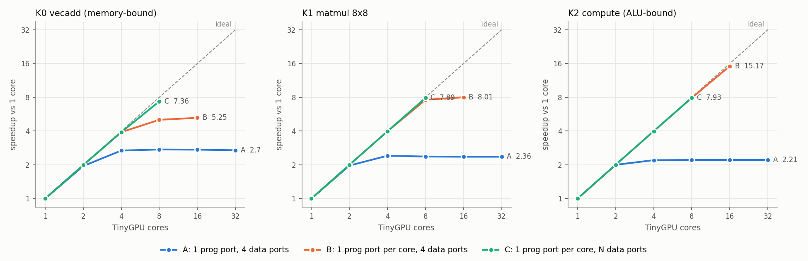
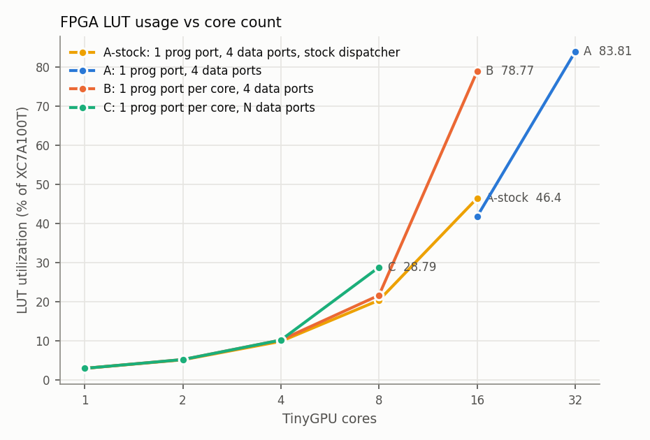
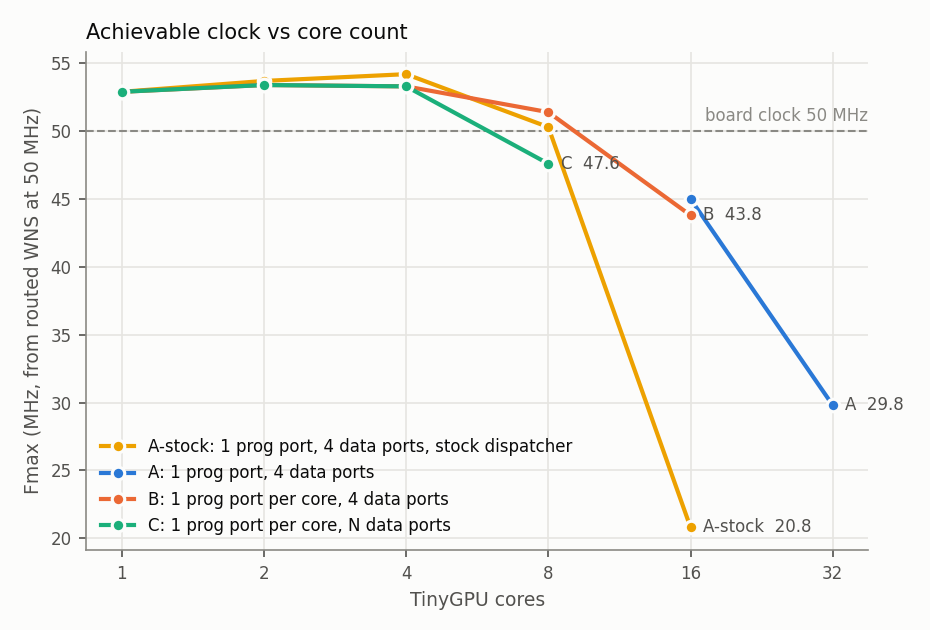

# TinyGPU on FPGA: current setup and multi-core scaling (Phases 1–2)

Board: Digilent Nexys 4 DDR (XC7A100T-1CSG324C) · Tools: Vivado 2024.2 · Date: 2026-10-21

All numbers below were measured on the board unless marked *sim* (simulation) or *est.* (estimate from timing reports).
Every hardware run checks its own output against a reference, and every cycle count was cross-checked against
simulation of the same RTL (they match exactly).

## Key findings

1. **The CNN currently runs on a dedicated CNN accelerator, not on TinyGPU.** It is now verified on the board:
   bit-exact with the golden model, 50 % → **97 % accuracy** after 5 epochs, **2,542 cycles (50.8 µs) per inference**
   at 50 MHz using 3.8 % of the LUTs. A file-path bug meant the earlier bitstream had no labels; fixed.
2. **Stock TinyGPU meets 50 MHz up to 8 cores** (WNS +0.13 ns). At 16 cores it fails (Fmax 20.8 MHz) because of the
   dispatcher's serial block-assignment loop (75 logic levels).
3. **Stock TinyGPU's speedup saturates at about 2.2–2.7× no matter how many cores are added**, because every core fetches
   every instruction through a single program-memory channel. Adding data-memory ports does not help (sim: 8 cores with 32 data ports, still 2.2×).
4. With **one instruction port per core**, scaling becomes near-linear for compute: **7.9× at 8 cores, 15.2× at 16 cores**
   (timing-clean, measured on the board). The memory-bound vecadd then stalls at about 5× (4 data ports) and needs more data ports (7.4× with 8).
5. **The cores themselves scale linearly (~1,000 LUTs each); the shared memory interconnect does not.** TinyGPU's memory
   controller is a full crossbar arbiter whose cost grows with ports × requesters: 23.5k LUTs for 16 instruction ports and
   20k LUTs (38 % of the design) for the data arbiter at 32 cores. From 8 cores on, it is also the critical path.
6. With a fixed dispatcher (`dispatch_rr.sv`, same cycle counts), **32 cores fit in the XC7A100T (84 % LUTs)**, but the
   memory arbiter limits the clock to ~30 MHz. So 32 cores run at 25 MHz, and with a single instruction port they gain nothing over 16.
7. **16 configurations were run on the board (48 kernel runs). All 11 timing-clean configurations produced correct results, and their cycle counts equal the RTL simulation exactly.** The only failure is stock 16 cores, which violates timing by 28 ns.

## 1. Current working setup (Phase 1)

### 1.1 Important clarification: what runs where

There are currently **two separate designs**:

| | CNN accelerator (`cnn_fpga/`) | TinyGPU (`tinygpu_fpga/`) |
|---|---|---|
| What it is | Fixed-function CNN engine: one FSM, one shared multiply-accumulate unit | Programmable SIMT GPU (adam-maj/tiny-gpu), runs kernels from program memory |
| Runs the CNN? | **Yes** (training + evaluation, on the board) | **Not yet.** Runs benchmark kernels (vecadd, matmul, ALU loop) |
| Why not on TinyGPU yet | n/a | Stock TinyGPU is 8-bit with 256 B data memory, 8-bit truncating MUL, no shifts. The Q4.12 CNN needs 16-bit data, a wide accumulator and ≥13 k words of image memory (Phase 3 work). |

The CNN accelerator is kept as the **correctness reference and performance baseline** for the future TinyGPU CNN kernel.

### 1.2 Setup documentation

| Item | CNN accelerator | TinyGPU |
|---|---|---|
| Repository / version | own RTL (`cnn_core.v`, `cnn_top.v`), bit-exact with `golden_model/golden_model.py` | github.com/adam-maj/tiny-gpu @ `02b6c2c` + changes listed in 1.3 |
| FPGA / board | XC7A100T-1CSG324C on Nexys 4 DDR | same |
| Number of cores | 1 engine, 1 MAC | stock config 2 cores × 4 threads; swept 1–32 cores (Phase 2) |
| Network | 8×8 input → Conv 3×3 (1→2) + ReLU → Conv 2×2 (2→2) → global avg pool → 2 logits (digit 0 vs 1), 38 parameters | – |
| Datatype / precision | Q4.12 16-bit fixed point, 40-bit accumulator, sigmoid LUT (512 entries) | 8-bit integer (mod 256) |
| Inference or training | **Both:** on-chip SGD training (batch 1, lr 2⁻³) and evaluation | kernel execution only |
| Dataset | 200 images (100 × "0", 100 × "1") from sklearn digits; accuracy measured on the training set (no held-out set yet) | – |
| LUT / FF / BRAM / DSP | 2,435 (3.84 %) / 1,164 (0.92 %) / 8.5 (6.3 %) / 4 (1.67 %) | see Phase 2 table (1 core: 1,877 / 1,520 / 3.5 / 0) |
| Clock / Fmax | runs at 50 MHz (MMCM from 100 MHz); WNS +4.92 ns → Fmax est. 66 MHz | runs at 50 MHz (or 40 / 25 MHz where needed); Fmax 53 MHz at 1 core |
| Power (Vivado est.) | 0.222 W total on-chip | see `tinygpu_fpga/build/*/power.rpt` |

### 1.3 Architectural changes made

CNN accelerator: designed from scratch (see `cnn_core.v` header). Phase 1 changes:
* **Bug fix:** the label file path was `.../MTP-1/golden_modellabels.hex` (missing `/`). Synthesis had silently built
  the previous bitstream **without labels** (CRITICAL WARNING Synth 8-4445), so earlier hardware accuracy numbers were not valid.
* Testbench fixes: `tb_top` timeout overflowed 32 bits and ended the simulation at t = 0; `tb_core` used a relative path.
* Added hardware **cycle counters** reported over UART (per evaluation pass, per training epoch, total).

TinyGPU (copy in `tinygpu_fpga/rtl/`, original repo untouched):
1. *(earlier)* dispatcher start-latch fix, Vivado 2024+ syntax fixes, controller array-initialisation fix.
2. `scheduler.sv`: `reg any_lsu_waiting = 1'b0;` inside an `always` block is a *static* initialiser (runs once), so the flag could stick at 1. Fixed to assign every cycle.
3. `gpu.sv`: the read-only program-memory controller's `consumer_write_valid` input was left floating; tied to 0.
4. **New `dispatch_rr.sv`** (optional variant): one block assignment and one block retirement per cycle using
   priority encoders, instead of the stock serial loop (see Phase 2 results for why). Cycle counts are identical to
   the stock dispatcher in every configuration except one (+6 cycles).
5. **New SoC wrapper `gpu_soc_top.sv`**: on-chip program/data memory with a configurable number of ports, loader,
   hardware cycle counter, result checker (all 256 data bytes compared against the expected image) and UART report.

### 1.4 CNN accelerator results (measured on the board, identical to simulation)

| Metric | Value |
|---|---|
| Inference latency | 2,542 cycles = **50.8 µs** @ 50 MHz (incl. loading the 64-pixel image) |
| Inference throughput | **19,670 images/s** (1,048 MACs/image → 20.6 MMAC/s, 41 MOPS) |
| Training step (forward + backward + update) | 6,154 cycles = 123.1 µs → 8,125 samples/s |
| Full run (6 evaluations + 5 training epochs) | 9,204,406 cycles = 184.1 ms |

| Epoch | 0 | 1 | 2 | 3 | 4 | 5 |
|---|---|---|---|---|---|---|
| Correct / 200 (board) | 100 | 132 | 160 | 179 | 189 | **194 (97 %)** |
| Golden model | 100 | 132 | 160 | 179 | 189 | 194 |

The core is also bit-exact with the golden model on all 38 parameters after every one of the 1000 training steps (`tb_core`).

## 2. Multi-core scaling experiment (Phase 2)

### 2.1 Method

* **SoC:** TinyGPU + on-chip memories. Program memory: `P` read ports. Data memory: `M` read ports + 1 write/cycle.
  Stock TinyGPU corresponds to `P = 1`, `M = 4`.
* **Benchmarks** (8-bit, all 256 data-memory bytes checked after every run):

  | Kernel | Threads (blocks of 4) | Character |
  |---|---|---|
  | K0 vecadd: A[i] += B[i] | 128 (32) | memory-bound: 3 memory ops, 9 instructions |
  | K1 matmul 8×8 | 64 (16) | mixed: 2 loads per inner-loop iteration, 26 instructions |
  | K2 compute: x ← x² + i, 16 iterations | 128 (32) | ALU-bound: 1 store, ~90 dynamic instructions |

* **Work distribution:** TinyGPU's dispatcher already distributes thread blocks automatically to whichever core is
  free; the kernels are written once (SIMT, using `%blockIdx`, `%blockDim`, `%threadIdx`) and are identical for every
  core count. No per-core manual assignment.
* **Measurement:** hardware counter from `start` to the dispatcher's `done`, in core clock cycles.
  Speedup = cycles(1 core) / cycles(N cores). Execution time = cycles / clock.
* **Timing:** each configuration is first implemented at 50 MHz. If it misses timing, it is re-implemented at a
  lower clock (40 or 25 MHz) so that **every reported hardware result comes from a timing-clean build**.
  Fmax est. = 1 / (T − WNS) from the 50 MHz-constrained build.
* **Series:** A = stock memory system (`P1 M4`); B = one program port per core (`P = N, M4`); C = one program port per core and N data ports (`P = N, M = N`).

### 2.2 FPGA implementation results

| Cores | Prog ports | Data ports | Dispatcher | Clock (MHz) | LUT | LUT % | FF | BRAM | DSP | WNS (ns) | Timing met | Fmax est. (MHz) | Critical path |
|---|---|---|---|---|---|---|---|---|---|---|---|---|---|
| 1 | 1 | 4 | stock | 50 | 1,877 | 2.96 | 1,520 | 3.5 | 0 | 1.089 | yes | 52.9 | ALU divider |
| 2 | 1 | 4 | stock | 50 | 3,259 | 5.14 | 2,489 | 3.5 | 0 | 1.394 | yes | 53.7 | ALU divider |
| 4 | 1 | 4 | stock | 50 | 6,253 | 9.86 | 4,400 | 3.5 | 0 | 1.535 | yes | 54.2 | ALU divider |
| 8 | 1 | 4 | stock | 50 | 12,904 | 20.35 | 8,226 | 3.5 | 0 | 0.127 | yes | 50.3 | dispatcher |
| 16 | 1 | 4 | stock | 50 | 29,416 | 46.4 | 15,883 | 3.5 | 0 | -28.094 | **no** | 20.8 | dispatcher |
| 16 | 1 | 4 | rr | 50 | 26,458 | 41.73 | 15,869 | 3.5 | 0 | -2.241 | **no** | 45.0 | data-mem arbiter |
| 16 | 1 | 4 | rr | 40 | 25,448 | 40.14 | 15,869 | 3.5 | 0 | 0.772 | yes | 41.3 | data-mem arbiter |
| 32 | 1 | 4 | rr | 50 | 53,133 | 83.81 | 31,201 | 3.5 | 0 | -13.595 | **no** | 29.8 | data-mem arbiter |
| 32 | 1 | 4 | rr | 25 | 51,851 | 81.78 | 31,202 | 3.5 | 0 | 0.604 | yes | 25.4 | data-mem arbiter |
| 2 | 2 | 4 | rr | 50 | 3,300 | 5.21 | 2,503 | 4.0 | 0 | 1.269 | yes | 53.4 | ALU divider |
| 4 | 4 | 4 | rr | 50 | 6,463 | 10.19 | 4,458 | 5.0 | 0 | 1.226 | yes | 53.3 | ALU divider |
| 8 | 8 | 4 | rr | 50 | 13,709 | 21.62 | 8,344 | 7.0 | 0 | 0.531 | yes | 51.4 | data-mem arbiter |
| 16 | 16 | 4 | rr | 50 | 49,938 | 78.77 | 21,075 | 3.0 | 0 | -2.814 | **no** | 43.8 | data-mem arbiter |
| 16 | 16 | 4 | rr | 40 | 49,005 | 77.29 | 21,075 | 3.0 | 0 | 0.165 | yes | 40.3 | prog-mem arbiter |
| 8 | 8 | 8 | rr | 50 | 18,253 | 28.79 | 8,501 | 9.0 | 0 | -0.998 | **no** | 47.6 | data-mem arbiter |
| 8 | 8 | 8 | rr | 40 | 17,654 | 27.85 | 8,501 | 9.0 | 0 | 0.492 | yes | 40.8 | data-mem arbiter |
| 16 | 16 | 16 | rr | – | *not completed:* synthesis stopped after > 2 h; est. ≈ 80k LUTs (≈ 126 %, does not fit) | | | | | | | | |

LUT/FF/BRAM/DSP are post-route. *Critical path* is the block containing the worst path. Fmax est. = 1/(T − WNS); it depends on the constraint the tool was given (e.g. 16 cores: 45.0 MHz from the 50 MHz build, 41.3 MHz from the 40 MHz build), so treat it as ±10 %.

### 2.3 Measured execution (board)

| Cores | Prog ports | Data ports | Dispatcher | Clock (MHz) | Timing met | vecadd cycles (speedup) | matmul cycles (speedup) | compute cycles (speedup) | All results correct | Board = sim |
|---|---|---|---|---|---|---|---|---|---|---|
| 1 | 1 | 4 | stock | 50 | yes | 4,035 (1.0x) | 20,131 (1.0x) | 31,395 (1.0x) | yes | yes |
| 2 | 1 | 4 | stock | 50 | yes | 2,073 (1.95x) | 10,209 (1.97x) | 15,721 (2.0x) | yes | yes |
| 4 | 1 | 4 | stock | 50 | yes | 1,508 (2.68x) | 8,364 (2.41x) | 14,284 (2.2x) | yes | yes |
| 8 | 1 | 4 | stock | 50 | yes | 1,473 (2.74x) | 8,491 (2.37x) | 14,181 (2.21x) | yes | yes |
| 16 | 1 | 4 | stock | 50 | **no** | timeout | timeout | timeout | **no** | **no** |
| 16 | 1 | 4 | rr | 50 | **no** | 1,479 (2.73x) | 8,537 (2.36x) | 14,196 (2.21x) | yes | yes |
| 16 | 1 | 4 | rr | 40 | yes | 1,479 (2.73x) | 8,537 (2.36x) | 14,196 (2.21x) | yes | yes |
| 32 | 1 | 4 | rr | 50 | **no** | 1,495 (2.7x) | 8,537 (2.36x) | 14,192 (2.21x) | yes | yes |
| 32 | 1 | 4 | rr | 25 | yes | 1,495 (2.7x) | 8,537 (2.36x) | 14,192 (2.21x) | yes | yes |
| 2 | 2 | 4 | rr | 50 | yes | 2,026 (1.99x) | 10,074 (2.0x) | 15,706 (2.0x) | yes | yes |
| 4 | 4 | 4 | rr | 50 | yes | 1,032 (3.91x) | 5,056 (3.98x) | 7,872 (3.99x) | yes | yes |
| 8 | 8 | 4 | rr | 50 | yes | 801 (5.04x) | 2,648 (7.6x) | 3,976 (7.9x) | yes | yes |
| 16 | 16 | 4 | rr | 50 | **no** | 769 (5.25x) | 2,512 (8.01x) | 2,070 (15.17x) | yes | yes |
| 16 | 16 | 4 | rr | 40 | yes | 769 (5.25x) | 2,512 (8.01x) | 2,070 (15.17x) | yes | yes |
| 8 | 8 | 8 | rr | 50 | **no** | 548 (7.36x) | 2,550 (7.89x) | 3,961 (7.93x) | yes | yes |
| 8 | 8 | 8 | rr | 40 | yes | 548 (7.36x) | 2,550 (7.89x) | 3,961 (7.93x) | yes | yes |

Speedup is relative to 1 core (stock), in cycles. Rows that miss timing are listed for completeness: they happened to run correctly on this board at room temperature, but only the timing-clean rows count as results. Cycle counts do not depend on the clock frequency, so each timing-clean row at 40/25 MHz reproduces the 50 MHz row's cycles exactly.





### 2.4 Where scaling becomes limited

The experiment separates four limits, in the order they appear:

1. **Instruction-fetch bandwidth (performance, from 2 cores).** Series A plateaus by 4 cores at 2.2× (compute), 2.4× (matmul) and 2.7× (vecadd).
   All cores share one program-memory channel. One core alone spends 11.1 cycles per instruction (compute: 31,395 cycles
   for 32 blocks × 88 instructions), and the measured plateau of 2.21× implies each fetch occupies the shared channel for ≈ 5 cycles
   (request → memory → relay → release handshake). Giving each core its own instruction port (series B) removes this limit:
   compute scales 2.0 / 4.0 / 7.9 / 15.2× for 2 / 4 / 8 / 16 cores.
2. **Data-memory bandwidth (performance, memory-bound kernels).** With 4 data channels shared by all threads, vecadd
   saturates at about 5× (B: 5.04× at 8 cores, 5.25× at 16). Doubling the data ports at 8 cores (C) raises it to 7.36×.
   Matmul is held at 8.0× at 16 cores with 4 ports (sim: 15.2× with 16 ports). Matmul also has only 16 thread blocks, so it
   cannot use more than 16 cores (workload-granularity limit).
3. **Interconnect/arbitration logic (area and clock, from 8 cores).** The controller lets any channel serve any requester and searches
   requesters serially. Its LUTs grow with channels × requesters, and its logic depth with the number of requesters:
   * data arbiter (4 channels): 9.9k LUTs @ 16 cores, 20k LUTs @ 32 cores; critical path 23 → 37 logic levels;
   * instruction arbiter with P = N: 1.1k LUTs @ 8 cores and 23.5k LUTs @ 16, more than the 16 cores themselves (15.9k).

   This is why 16 cores with per-core instruction ports uses 77 % of the device, and why 32 such cores cannot fit.
4. **Control logic (clock).** At 16 cores the stock dispatcher's loop over cores becomes a 75-level chain (20.8 MHz).
   A one-block-per-cycle dispatcher removes it at no cycle cost.

The per-core datapath itself is not a limit: ~1,000 LUTs and ~950 FFs per core, 0 DSPs (TinyGPU's 8-bit MUL/DIV map to LUTs).
For 1–4 cores the critical path is the core's own combinational 8-bit **divider** (Fmax ≈ 53 MHz). That path is really a
2-cycle path, so it could be multicycle-constrained or pipelined.

**Execution time including clock frequency** (compute kernel, timing-clean builds):
1 core 31,395 cycles @ 50 MHz = 628 µs · 8 cores (B) 3,976 @ 50 MHz = 79.5 µs (7.9×) ·
16 cores (B) 2,070 @ 40 MHz = 51.8 µs (12.1× wall-clock) · 32 cores (A) 14,192 @ 25 MHz = 568 µs (1.1×).

## 3. Proposed next steps

Recommended before, or together with, the scheduler / load-sharing phase:

1. **Private instruction path per core** (direct port or a small instruction cache/buffer instead of the shared crossbar).
   This keeps the near-linear compute scaling of series B while removing the 23.5k-LUT instruction arbiter, which should
   make 32 cores fit.
2. **Banked data memory** (address-interleaved banks with per-bank arbitration, or per-core local/shared memory)
   instead of the all-to-all controller. This targets both the vecadd/matmul bandwidth limit and the arbiter's area and clock cost.
3. **Scheduler / workload sharing** (the professor's next phase): TinyGPU already spreads thread blocks across free cores
   automatically. Extensions: 16-bit block IDs and thread counts (currently ≤ 255 threads); a kernel/command queue so that a
   sequence of layers (conv1 → conv2 → pooling) runs without host intervention; and a fix for partial blocks (the scheduler
   takes the next PC from the *last* thread, which is disabled in a partially filled block).
4. **CNN on TinyGPU:** widen the datapath to 16 bit (Q4.12) with a 32/40-bit MAC accumulator, a shift-right-arithmetic
   instruction, ReLU/MAX and a 16-bit address space. Then run conv1 (72 output pixels = 72 threads) and conv2 (50 threads)
   as kernels and compare them against `cnn_core` and the golden model, which are already bit-exact references.
5. ASIC: the repository already has an OpenLane flow. Run it after items 1–2, because the arbiter structure is the main driver of area.

## 4. Reproducing

```sh
# CNN (Phase 1)
cd cnn_fpga && vivado -mode batch -source scripts/build_cnn.tcl
python ../scripts/uart_capture.py build/cnn_top.bit --until "^D0 "

# TinyGPU sweep (Phase 2)
cd tinygpu_fpga
python kernels/kernels.py                       # assemble kernels -> mem/*.hex
sim/run_sim.sh 8 8 4 4 rr                        # simulate one configuration
python scripts/sweep.py build 8,8,4,rr 16,1,4,rr,40   # implement (N,P,M,dispatcher,MHz)
python scripts/run_board.py                      # program + measure every bitstream
python scripts/analyze.py                        # CSVs, tables.md, figures
```
Raw data: `tinygpu_fpga/results/fpga_sweep.csv`, `board_runs.csv`, `scaling.csv`, `board_logs/`, per-build reports in `tinygpu_fpga/build/<config>/`.
